# The issue workflow: `/issue-kit:implement-issue 12`

One command takes a GitHub issue from the issue text to a pull request: it reads the issue, checks its dependencies
and the requirements document, plans, implements with tests, verifies, profiles the session, records the result on the
issue, opens the pull request and recommends the next issue. The issue's labels select the **lane**: a label of
`lanes.bug` → Bug lane (reproduce, fix the root cause, root-cause comment); a label of `lanes.testAuthoring` and an
issue that only asks for tests of existing behaviour → Test-authoring lane (no production code, the tests are the
deliverable); every other issue → Feature lane (acceptance list, plan, build, implementation comment). A change to CI
workflows, configuration or documentation takes the Feature lane, even with a test-authoring label. There are two
checkpoints with the user, the plan review and the result confirmation; every outward action (commit, push, comment,
pull request) needs its own "yes".

The body is `skills/implement-issue/SKILL.md`, with `references/context-budget.md` and `references/shipping.md`.
Repository values appear as keys of `issue-kit.config.json` (see [CONFIGURATION.md](../CONFIGURATION.md)), for
example `baseBranch` or `commands.build`. The diagram below shows who does what at each step. Legend:

- 💻 — the main session, on whatever model it was started with;
- agents have their model written out: it is set in `agents/*.md` of the plugin and does not depend on the session's
  model; the developer's model is chosen per call from the plan's complexity;
- 🤖 — an agent call. The plugin agents (`agents/`) are the defaults of the `roles` keys, and a repository can name
  other agents there. `roles.architect` and `roles.securityReviewer` have no default: they are optional, use their
  own model, and an empty role means that part is skipped with one line;
- 🧩 — a skill: a plugin skill (`skills/`), or the skill that `roles.debugSkill`, `roles.testsSkill` or
  `profile.skill` names (optional);
- 🙋 — a point where the process waits for the user.

```
/issue-kit:implement-issue 12
│
├─ Configuration ─────────────────── 💻 Get-IssueKitConfig.ps1 -Sources
│                                    (error → stop, show the message: file and key)
│                                    (no issue-kit.config.json → defaults apply, one line
│                                     that /issue-kit:init-config drafts the file)
├─ 0. Start from the base branch ─── 💻 git status → git switch <baseBranch> → git pull --ff-only
│                                    (uncommitted changes → stop, 🙋 commit, stash or discard?)
│                                    (left branch has commits not in baseBranch → mention it)
│                                    (fast-forward pull fails → stop, report; never force)
│                                    (stay on the current branch only if the user says so;
│                                     then pull it if it tracks a remote)
│                                    get_usage silently: the start reading for the profile
│                                    (no tool → skip)
├─ 1. Read the issue ─────────────── 💻 🧩 issue-kit:github-issue (body, comments)
│                                    (no number → 🧩 issue-kit:next-issue → 🙋 which issue?)
│                                    (issue closed → stop)
│                                    (parent or sub-issues → the scope is this issue only)
├─ 2. Dependencies, lane, owner ──── 💻 gh api graphql (blockedBy) + issueSections.dependencies
│                                    lane from lanes.bug / lanes.testAuthoring, else Feature
│                                    gh issue edit --add-assignee @me
│                                    (open blocker → stop, 🙋)
│                                    (labels and text disagree → 🙋)
│
├─ 3. Understand the problem ─────── 💻 reads only the linked sections of prd.path (if set)
│    ├─ Bug: reproduce with a failing test (🧩 roles.debugSkill, if set)
│    │          (cannot reproduce → 🙋)
│    ├─ Feature / Test-authoring: 🧩 issue-kit:github-issue → acceptance list
│    │          (material gap → 🙋)
│    ├─ (issue needs behaviour outside prd.path → 🙋 approve the requirements change)
│    └─ (broad code search → 🤖 Explore, summary of at most 30 lines)
│
├─ 4. Plan ──────────────────────────────────▶ 🤖 issue-kit:issue-planner (Opus, read-only)
│                                    (cross-layer change → 🤖 roles.architect, optional)
│                                    (trivial change → 💻 plans inline)
│                                    (coverage checked against the code: inputs, branches,
│                                     boundaries)
│                                    ◀── plan in plans.language + complexity S/M/L
├─ 5–6. Save and review ──────────── 💻 <plans.dir>/<plans.nameTemplate>
│                                    🙋 review → edits → review again
├─ 7. Plan approved ──────────────── 💻 review decisions → plan file
│                                    🙋 /compact (ready command)
│
├─ 8. Implement ─────────────────────────────▶ 🤖 issue-kit:issue-developer (Sonnet · Opus for L)
│                                    tests (🧩 roles.testsSkill, if set) · docs in the same change
│                                    (trivial change → 💻 implements inline)
│                                    ◀── change summary (no commits)
│                                    (plan wrong in the code → plan updated, 🙋 before diverging)
│                                    (Test-authoring: tests find broken behaviour → stop, 🙋)
│
├─ 9. Build and test
│    ├─ 💻 ──1 call──▶ 🤖 issue-kit:build-runner (Haiku), scope full
│    │                   commands.build
│    │                   commands.testFull (output to a file)
│    │                   commands.format
│    │    💻 ◀── verbatim summary lines + first errors
│    │    (red → errors to 🤖 issue-kit:issue-developer → 🤖 issue-kit:build-runner again)
│    │    (empty command → NOT CONFIGURED, named as not done in step 11)
│    ├─ 💻 review of the added comments (if commentReview.globs is set)
│    ├─ if a changed file matches securityReview.triggers:
│    │    💻 ──▶ 🤖 roles.securityReviewer (optional) ◀── findings → fixes
│    ├─ (build runner and triggered review are skipped only on the user's explicit word)
│    └─ 🙋 /compact
├─ 10. Verify ────────────────────── 💻 every acceptance item → test / command / result
│                                    (Bug: the reproducing test passes, the reproduction is gone)
│                                    (item without runtime behaviour — CI, configuration,
│                                     documentation — by a command, a test or the CI run of the
│                                     pull request; an item only CI confirms stays open until then)
│                                    (Test-authoring: the new tests are in the build runner's
│                                     summary, pass and assert the intended behaviour)
│                                    (failure → back to 8, or to 4 if the approach changes)
│                                    (skip only on the user's explicit word)
├─ 11. Confirm the result ────────── 💻 table: item → how verified → result (or root cause)
│                                    🙋 "is the result acceptable?" → /compact
│                                    (no → back to 8 or 4)
│
├─ 12. Commit and push
│    ├─ 💻 git fetch; origin/<baseBranch> moved → git pull --ff-only and step 9 again
│    ├─ 💻 ticks the plan checklist and the issue's task line in a multi-issue plan in plans.dir
│    ├─ 🙋 "yes, commit"
│    │    💻 ──1 call──▶ 🤖 issue-kit:skill-runner (Haiku) + 🧩 issue-kit:git-commit
│    │                     creates the branch (branchPattern) from the fresh baseBranch
│    │                     git add <given list>
│    │                     writes the message → git commit -F
│    │    💻 ◀── "a1b2c3d #12 Title"
│    │    (trivial change or several commits → 💻 loads 🧩 issue-kit:git-commit and runs its check;
│    │     several commits for one issue → one line 1 "#12 Title", action lines differ)
│    │    (commitCheck.enabled → the hook checks every new commit message;
│    │      violation → git commit --amend before the push)
│    ├─ 💻 🧩 profile.skill (main session only; profile.enabled false or no skill → one line, skip)
│    │    summary in a few lines: calls, cost units, USD estimate, activities, weekly limit
│    │    🙋 "save the profile and add it to the commit?"
│    │    yes → save -WorkItem 12 -Lane <lane> -NoCommit → git add <record> → git commit --amend
│    │         (commit already pushed → new commit: 🤖 issue-kit:skill-runner + 🧩 issue-kit:git-commit)
│    └─ 🙋 "yes, push" → 💻 git push -u origin <branch>
│
├─ 13. Comment, acceptance, pull request
│    ├─ 🙋 "yes, comment"
│    │    💻 ──1 call──▶ 🤖 issue-kit:skill-runner (Haiku) + 🧩 issue-kit:github-issue
│    │                     text → gh issue comment --body-file
│    │    💻 ◀── comment URL
│    ├─ 🙋 "yes, tick the acceptance" → 💻 Set-AcceptanceChecks.ps1 (- [ ] → - [x])
│    │    (no checklist in the body → skip; unverified items stay unticked)
│    ├─ 🙋 "yes, pull request"
│    │    💻 ──1 call──▶ 🤖 issue-kit:skill-runner (Haiku) + 🧩 issue-kit:open-pr
│    │                     text → gh pr create --body-file (Closes #12)
│    │    💻 ◀── pull request URL
│    └─ 💻 gh pr checks (once, no polling; failed check → fix on the same branch after "yes")
│
└─ 14. What next ─────────────────── 💻 🧩 issue-kit:next-issue -AssumeClosed 12
                                     → "merge the pull request → new session →
                                        /issue-kit:implement-issue N" (+ up to two alternatives)
```

The same flow as a Mermaid diagram, without `/compact` and the small commands, which are in the tree above. Grey
blocks are the main session, blue are agents, green are skills, yellow are waits for the user, red is a return to
implementation.

```mermaid
flowchart TD
    START(["/issue-kit:implement-issue N"]) --> S0["💻 0. Configuration · base branch<br/>git switch baseBranch · git pull --ff-only<br/>get_usage (start reading)"]:::session
    S0 -. "configuration error · fast-forward fails" .-> STOP(["stop"])
    S0 -. "uncommitted changes" .-> U0{{"🙋 commit, stash or discard?"}}:::user
    U0 -.-> S0
    S0 --> S1["💻 1. Read the issue<br/>🧩 issue-kit:github-issue"]:::skill
    S1 -. "no number" .-> NI0["🧩 issue-kit:next-issue"]:::skill
    NI0 -.-> U1{{"🙋 which issue?"}}:::user
    U1 -.-> S1
    S1 -. "issue closed" .-> STOP
    S1 --> S2["💻 2. Dependencies, lane, owner"]:::session
    S2 -. "open blocker · labels and text disagree" .-> UB{{"🙋 how to continue?"}}:::user
    UB -.-> S2
    S2 --> S3["💻 3. Understand the problem<br/>prd.path · acceptance (🧩 issue-kit:github-issue)<br/>or reproduction (🧩 roles.debugSkill)"]:::session
    S3 -. "cannot reproduce · material gap" .-> U3{{"🙋 how to continue?"}}:::user
    U3 -.-> S3
    S3 -. "requirements change needed" .-> U3P{{"🙋 approve the requirements change"}}:::user
    U3P -.-> S3
    S3 --> A4["4. Plan<br/>🤖 issue-kit:issue-planner · Opus<br/>plan + complexity S/M/L"]:::agent
    A4 -. "cross-layer change" .-> A4A["Design<br/>🤖 roles.architect · optional"]:::agent
    A4A -.-> A4
    A4 --> S5["💻 5–6. Save the plan<br/>plans.dir"]:::session
    S5 --> U5{{"🙋 review the plan"}}:::user
    U5 -- "feedback" --> S5
    U5 -- "approved" --> A8["8. Implement<br/>🤖 issue-kit:issue-developer · Sonnet, Opus for L<br/>🧩 roles.testsSkill"]:::agent
    A8 -. "Test-authoring: broken behaviour" .-> U8{{"🙋 separate defect: how to continue?"}}:::user
    subgraph STEP9["9. Build and checks"]
        A9["Build and test<br/>🤖 issue-kit:build-runner · Haiku<br/>build · test · format"]:::agent
        S9["💻 Review of the added comments<br/>commentReview.globs"]:::session
        A9S["Security review<br/>🤖 roles.securityReviewer · optional"]:::agent
        A9 -- "green" --> S9
        S9 -. "file matches securityReview.triggers" .-> A9S
    end
    A8 --> A9
    S9 --> S10["💻 10. Verify every<br/>acceptance item"]:::session
    A9S -.-> S10
    S10 --> U11{{"11. 🙋 is the result acceptable?"}}:::user
    A9 -- "red" --> FIX
    A9S -. "findings" .-> FIX
    S10 -- "failed item" --> FIX
    U11 -- "no" --> FIX
    FIX(["↩ fixes: back to step 8, or 4 if the approach changes"]):::fix
    FIX --> A8
    subgraph STEP12["12. Commit and push"]
        S12F["💻 git fetch<br/>base moved → pull, step 9 again"]:::session
        U12{{"🙋 yes, commit"}}:::user
        A12["Commit<br/>🤖 issue-kit:skill-runner · Haiku<br/>🧩 issue-kit:git-commit"]:::agent
        P12["💻 Session profile<br/>🧩 profile.skill"]:::skill
        U12S{{"🙋 save the profile?"}}:::user
        S12S["💻 save · git commit --amend"]:::session
        U12P{{"🙋 yes, push"}}:::user
        S12P["💻 git push"]:::session
        S12F --> U12 --> A12 --> P12 --> U12S
        U12S -- "yes" --> S12S --> U12P
        U12S -- "no" --> U12P
        U12P --> S12P
    end
    subgraph STEP13["13. Comment, acceptance, pull request"]
        U13C{{"🙋 yes, comment"}}:::user
        A13C["Issue comment<br/>🤖 issue-kit:skill-runner · Haiku<br/>🧩 issue-kit:github-issue"]:::agent
        U13T{{"🙋 yes, tick the acceptance"}}:::user
        S13T["💻 Acceptance ticks<br/>Set-AcceptanceChecks.ps1"]:::session
        U13P{{"🙋 yes, pull request"}}:::user
        A13P["Pull request<br/>🤖 issue-kit:skill-runner · Haiku<br/>🧩 issue-kit:open-pr"]:::agent
        S13CI["💻 gh pr checks (once)"]:::session
        U13C --> A13C --> U13T --> S13T --> U13P --> A13P --> S13CI
    end
    U11 -- "yes" --> S12F
    S12P --> U13C
    S13CI --> NI14["💻 14. What next<br/>🧩 issue-kit:next-issue -AssumeClosed N"]:::skill
    NI14 --> END(["merge the pull request → new session → /issue-kit:implement-issue"])

    classDef session fill:#f3f4f6,stroke:#6b7280,color:#111827
    classDef agent fill:#dbeafe,stroke:#2563eb,color:#1e3a8a
    classDef skill fill:#dcfce7,stroke:#16a34a,color:#14532d
    classDef user fill:#fef3c7,stroke:#d97706,color:#78350f
    classDef fix fill:#fee2e2,stroke:#dc2626,color:#7f1d1d
    style STEP9 fill:#f8fafc,stroke:#64748b,stroke-dasharray:4 3
    style STEP12 fill:#f8fafc,stroke:#64748b,stroke-dasharray:4 3
    style STEP13 fill:#f8fafc,stroke:#64748b,stroke-dasharray:4 3
```



The process waits for the user:

- on uncommitted changes, the choice of the issue (when no number is given), an open blocker, labels and text that
  disagree, a defect that cannot be reproduced, a material gap in the requirements and a change of the requirements
  document (steps 0–3); a configuration error, a failed fast-forward pull or a closed issue stops the process;
- on the plan review (steps 5–6), and before the implementation diverges materially from the plan (step 8);
- when Test-authoring tests find broken behaviour, which is a separate defect (step 8);
- on the result confirmation (step 11);
- before each outward action: commit, push, comment, acceptance ticks, pull request, a fix of a failed CI check
  (steps 12–13) — each needs its own "yes";
- on the question whether to save the session profile and add the record to the commit (step 12, between the commit
  and the push);
- on the three ready `/compact` commands (after steps 7, 9 and 11); they can be skipped while the conversation is
  short.

The main session keeps every gate: the plan review, both confirmations, the go-ahead before every outward action, the
push, the acceptance ticks and the CI check. `issue-kit:issue-developer` never commits, pushes or posts, and
`issue-kit:skill-runner` carries out one approved action and never pushes. The developer's "passed" is input, not
proof: the build and the tests run again in `issue-kit:build-runner`. The user merges the pull request.

Context economy is built in: three `/compact` milestones with a ready focus text, a runaway guard on the length of a
turn, one issue per session, narrow reading, small tool output, delegation of noisy work to agents and scratch paths
outside the repository (`skills/implement-issue/references/context-budget.md`).

The session profile comes from the skill that `profile.skill` names (default `harness-kit:profile-session`): step 0
silently takes the start reading of the weekly limit, step 12 profiles the session after the commit. The push, the
comment and the pull request come after the profile and are not part of it. See
[Session profile](../README.md#session-profile-contract-with-harness-kit).

Several small issues on one branch are described in [implement-issues](implement-issues.md).
