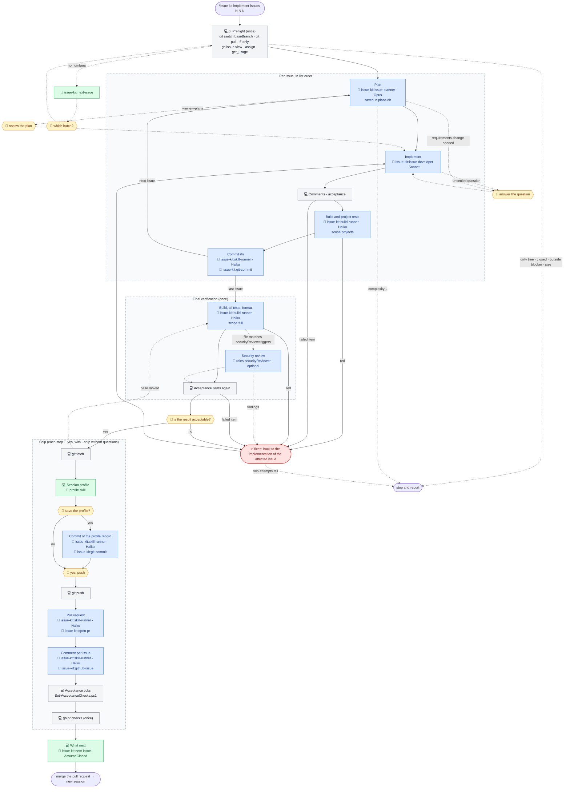

# The batch workflow: `/issue-kit:implement-issues 5 6 7`

For small issues, a plan review stop for each issue costs more than the work itself. The command runs the
[`/issue-kit:implement-issue`](implement-issue.md) workflow for each issue in the given order on **one branch** (named
by `batchBranchPattern`, created at the first commit, not earlier), with one commit per issue (`#<n> <exact title>`).
Then it verifies the whole branch once and opens **one pull request**. The batch runs without review stops: it stops
only on a question it cannot settle itself, and it reports every debatable decision at the end. Each issue takes its
lane from its labels, as in `implement-issue`. Optional flags: `--review-plans` keeps the plan review stop of each
issue; `--ship` pre-authorises push, pull request, issue comments and acceptance ticks. Without issue numbers the
command recommends a batch with `issue-kit:next-issue`.

The body is `skills/implement-issues/SKILL.md`. It does not copy the `implement-issue` workflow: it reads
`skills/implement-issue/SKILL.md` and its `references/` and lists only the differences, so a change of the single-issue
workflow reaches the batch too. Repository values appear as keys of `issue-kit.config.json` (see
[CONFIGURATION.md](../CONFIGURATION.md)). Legend:

- 💻 — the main session, on whatever model it was started with;
- agents have their model written out: it is set in `agents/*.md` of the plugin and does not depend on the session's
  model;
- 🤖 — an agent call. The plugin agents (`agents/`) are the defaults of the `roles` keys, and a repository can name
  other agents there. `roles.securityReviewer` has no default: it is optional and uses its own model;
- 🧩 — a skill: a plugin skill (`skills/`), or the skill that `profile.skill` names (optional);
- 🙋 — a point where the process waits for the user.

```
/issue-kit:implement-issues 5 6 7 [--review-plans] [--ship]
│
├─ 0. Preflight (once) ───────────── 💻 configuration, as in implement-issue
│                                    git status → git switch <baseBranch> → git pull --ff-only
│                                    (uncommitted changes → stop)
│                                    (no numbers → 🧩 issue-kit:next-issue → 🙋 which batch?)
│                                    gh issue view for each issue, lane from its labels
│                                    (issue closed → stop)
│                                    (open blocker not earlier in the list → stop)
│                                    (list order contradicts a dependency → stop)
│                                    (limit: 5 issues of complexity S or M)
│                                    gh issue edit --add-assignee @me
│                                    get_usage silently: the start reading for the profile
│
├─ Per issue, in list order (implement-issue steps 1–10)
│    ├─ 💻 ──▶ 🤖 issue-kit:issue-planner (Opus, read-only) ◀── plan + complexity S/M/L
│    │          plan saved in plans.dir, work goes on
│    │          (L → stop, run that issue alone with /issue-kit:implement-issue)
│    │          (--review-plans → 🙋 review the plan)
│    │          (requirements change needed → stop, 🙋 approve)
│    ├─ 💻 ──▶ 🤖 issue-kit:issue-developer (Sonnet) ◀── change summary (no commits)
│    │          (unsettled question → stop, 🙋; debatable choice → plan's Decisions
│    │           and the running list, no stop)
│    ├─ 💻 review of the added comments; verification of the acceptance items (step 10)
│    ├─ 💻 ──1 call──▶ 🤖 issue-kit:build-runner (Haiku), scope projects
│    │          (the test projects the change touches; commands.testProject empty → scope full)
│    │          (red → back to implementation; never commit red)
│    ├─ 💻 ──1 call──▶ 🤖 issue-kit:skill-runner (Haiku) + 🧩 issue-kit:git-commit
│    │          the first commit creates the branch (batchBranchPattern) from the fresh baseBranch
│    │          the commit holds the plan file and the issue's task line in a multi-issue plan
│    │          ◀── "a1b2c3d #5 Title"
│    │          (commitCheck.enabled → the hook checks the message)
│    └─ (more than about 40 tool calls → 🙋 /compact between issues)
│
├─ Final verification (once) ─────── 💻 on git diff <baseBranch>...HEAD
│    ├─ 💻 ──1 call──▶ 🤖 issue-kit:build-runner (Haiku), scope full
│    │                   (change touches a UI project → its UI test run is in the summary)
│    ├─ if a changed file matches securityReview.triggers:
│    │    💻 ──▶ 🤖 roles.securityReviewer (optional) ◀── findings
│    ├─ 💻 verifies again the acceptance items the final run could affect
│    └─ failure or finding → fix as an additional commit under the issue's #<n>,
│       then the affected checks again
│
├─ Report and confirmation ───────── 💻 table: issue → commit → acceptance → how verified → result
│                                    💻 verification results, debatable decisions, gaps
│                                    🙋 "is the result acceptable?" (no → rework the issue,
│                                     verify again)
│
├─ Ship (each step 🙋 "yes"; with --ship without questions)
│    ├─ 💻 git fetch; origin/<baseBranch> moved → git pull --ff-only, final verification again
│    ├─ 💻 🧩 profile.skill (once; profile.enabled false or no skill → one line, skip)
│    │    🙋 "save the profile?" — asked even with --ship
│    │    yes → save -WorkItem <first> -Lane <lane> → 💻 ──1 call──▶ 🤖 issue-kit:skill-runner (Haiku)
│    │         + 🧩 issue-kit:git-commit: separate commit "#<last> …" with the record (never amend)
│    ├─ 💻 git push -u origin <branch>
│    ├─ 💻 ──1 call──▶ 🤖 issue-kit:skill-runner (Haiku) + 🧩 issue-kit:open-pr
│    │                   one pull request, one "Closes #<n>" line per issue
│    ├─ 💻 ──1 call per issue──▶ 🤖 issue-kit:skill-runner (Haiku) + 🧩 issue-kit:github-issue
│    │                   comment with the pull request link
│    │    💻 Set-AcceptanceChecks.ps1 for each issue (- [ ] → - [x])
│    └─ 💻 gh pr checks (once, no polling)
│
└─ What next ─────────────────────── 💻 🧩 issue-kit:next-issue -AssumeClosed <every issue of the batch>
                                     → "merge the pull request → new session →
                                        /issue-kit:implement-issue(s)"
```

The same flow as a Mermaid diagram, without the small commands, which are in the tree above. Grey blocks are the main
session, blue are agents, green are skills, yellow are waits for the user, red is a return to implementation.



The batch stops and reports, and leaves all finished commits in place, on: an unsettled question, a change of the
requirements document that needs approval, an open blocker outside the batch, a closed issue, a plan of complexity
`L`, a reproduction that fails (Bug lane), a build or test failure that two fix attempts do not resolve, or a change
that would need to touch an earlier issue's commit in a way that is not a plain follow-up. Commits of the batch are
never amended or rewritten: fixes go forward. The one exception is the message check that the skill runner runs on the
commit it has just made. For the same reason the session profile record goes into the branch as a separate commit,
not by an amend as in `/issue-kit:implement-issue`.

The process waits for the user:

- on the choice of the batch (when no numbers are given), an unsettled question or a change of the requirements
  document (preflight and the work on the issues);
- on the plan review of each issue — only with `--review-plans`;
- on the ready `/compact` command between issues, once the conversation passes about 40 tool calls;
- on the result confirmation of the whole batch;
- on the question whether to save the session profile (ship, before the push) — even with `--ship`;
- before each outward action: push, pull request, issue comments and acceptance ticks — each needs its own "yes"
  unless `--ship` pre-authorised them. Starting the batch authorises the commits, one per issue.

Debatable decisions are made without a stop, recorded in the *Decisions* section of each issue's plan and reported
together at the end. A batch holds at most 5 issues of complexity S or M.
