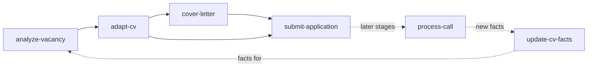

# jobsearch-kit plugin

A job search workflow for Claude Code: vacancy analysis with company research, CVs tailored from one master file,
cover letters, application records and call transcripts. Documents are built as Word and PDF files by scripts, and
every CV is checked against the candidate's own wording rules.

The plugin holds procedures, scripts and a template. All personal data stays in your **workspace**: a folder (best a
git repository) with your facts, master CV, applications and notes.

## Skills

Invoke a skill by its name or as `/jobsearch-kit:<skill>`.

| Skill | When to use it |
|---|---|
| `analyze-vacancy` | You share a vacancy link or text: fit table, company research, then the documents |
| `adapt-cv` | Only a tailored CV for a vacancy (also called by `analyze-vacancy`) |
| `cover-letter` | A cover letter or motivation letter: write, lint, build, check |
| `submit-application` | Before you submit (PDFs, links, form answers) and after (confirmation, records) |
| `update-cv-facts` | You confirm or correct a fact: facts, master CV, rules, form answers, full CV |
| `process-call` | A recording of a call or interview: transcript, summary, company notes |



A vacancy goes from `analyze-vacancy` through `adapt-cv` and `cover-letter` to `submit-application`. Calls after it go
through `process-call`. Every new fact goes through `update-cv-facts`.

The skills never submit forms, send messages or commit on their own.

## Contents

| Folder | Content |
|---|---|
| `skills/` | The six skills |
| `reference/` | Read by every skill: `workspace.md` (layout, settings, precedence), `rules.md` (rules, documents, style), `scripts.md` (commands, dependencies, environment) |
| `scripts/` | CV and letter build, wording lint, PDF export, page preview, transcription, dependency setup |
| `templates/workspace/` | A starter workspace with a fictional candidate |

## Requirements

- Windows with Microsoft Word (the scripts drive Word through COM for PDF export and previews).
- Node.js (with `npm`).
- PowerShell 7 (`pwsh`) and Windows PowerShell 5.1 (`powershell.exe`, part of Windows).
- `git` (the skills compare CV text with `git diff`).
- For `process-call` only: [`uv`](https://docs.astral.sh/uv/) and an NVIDIA GPU with CUDA 12. Without a GPU, pass
  `--device cpu` to `transcribe.py` (much slower).
- The built-in browser of the Claude desktop app (or another browser tool) to read vacancy pages.

## Install

1. Register the marketplace: see `../../README.md`.
2. Install the plugin, then start a new session:

   ```bash
   claude plugin install jobsearch-kit@ai-plugins
   ```

3. Install the npm packages (once per machine, and after an update that changes `scripts/package.json`). Run it from
   the plugin folder of a clone, or from the installed copy:

   ```bash
   pwsh -File plugins/jobsearch-kit/scripts/install-deps.ps1
   ```

   The packages go to `%LOCALAPPDATA%\ai-plugins\jobsearch-kit`. To use another folder, pass `-DepsDir <folder>`:
   the script then sets the user environment variable `JOBSEARCH_DEPS` to that folder and says so in its output.

4. Optional, for call transcripts:

   ```bash
   pwsh -File plugins/jobsearch-kit/scripts/install-whisper.ps1
   ```

   The venv goes to `%LOCALAPPDATA%\ai-plugins\jobsearch-kit\whisper`; the model (about 3 GB) downloads on the first
   run. To use another folder, or to reuse a whisper environment that already exists, pass `-WhisperDir <folder>`:
   the script keeps what is there, and sets the user environment variable `JOBSEARCH_WHISPER` to that folder.

   An environment variable set by these scripts reaches only new terminals and new Claude Code sessions. To check
   or remove one: `[Environment]::GetEnvironmentVariable('<name>', 'User')`,
   `[Environment]::SetEnvironmentVariable('<name>', $null, 'User')`.

## Start a workspace

1. Copy the template into a new folder and make it a git repository:

   ```powershell
   Copy-Item -Recurse plugins\jobsearch-kit\templates\workspace <your workspace>
   git -C <your workspace> init
   ```

2. Replace the fictional candidate with your own data:
   - `CLAUDE.md`: your languages, cover letter preferences and personal rules (see `reference/workspace.md`,
     "Workspace settings").
   - `MyProfile/candidate_facts.md`: your facts, with dates. This is the only source of truth.
   - `MyProfile/cv/cv_master.yaml`: all your CV text (format at the top of `scripts/cv.js`).
   - `MyProfile/cv/cv_rules.yaml`: patterns for claims you must not make.
   - `MyProfile/application_defaults.yaml`: your standard form answers.
   - `MyProfile/cv/profile_full.yaml`: set `output` to your name.
3. Open the workspace in Claude Code and check the build: ask Claude to rebuild the full CV, or run from the
   workspace root:

   ```bash
   node "<plugin folder>/scripts/cv.js" MyProfile/cv/profile_full.yaml
   ```

4. Commit the workspace. The skills compare CV text with `git diff`, which shows nothing for files that git does
   not track yet.
5. Share a vacancy link and ask Claude to analyze it.

The scripts find the workspace root by looking upwards for `MyProfile/cv/cv_master.yaml`; `--root <folder>` or the
`JOBSEARCH_ROOT` environment variable override it.

## Update

`install` copies the plugin into the plugin cache, and sessions run that copy. After a change in the clone (your own
or a pull):

```bash
claude plugin uninstall jobsearch-kit@ai-plugins
claude plugin install jobsearch-kit@ai-plugins
```

Then start a new session. If `scripts/package.json` changed, run `install-deps.ps1` again. Your workspace and the
dependency folders are not touched.

## Uninstall

```bash
claude plugin uninstall jobsearch-kit@ai-plugins
```

Delete `%LOCALAPPDATA%\ai-plugins\jobsearch-kit` to remove the npm packages, the whisper venv and the model.

## Troubleshooting

| Symptom | Cause and fix |
|---|---|
| `npm package "docx" not found` | Run `install-deps.ps1`. If you used another `-DepsDir`, set `JOBSEARCH_DEPS` |
| `WARNING: no wording rules ... nothing was checked` | The script did not find the workspace: run it from the workspace root or pass `--root <workspace>` |
| The build stops on a wording rule | Fix the text. Change `cv_rules.yaml` only when `candidate_facts.md` changed |
| Word export hangs | It runs under Windows PowerShell 5.1: run `export-pdf.ps1` and `render-preview.ps1` with `pwsh` |
| `The process cannot access the file` on a `.docx` | Word has the file open: close it and run the step again |
| The PDF has no links | It was printed with "Microsoft Print to PDF": use `export-pdf.ps1` |
| `transcribe.py` cannot find CUDA DLLs | Run `install-whisper.ps1` again, or pass `--device cpu` |
| A skill is not found or plugin changes do not appear | Reinstall as in "Update", then start a new session |
