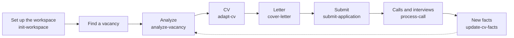

# jobsearch-kit user guide

This guide tells you which skill to use in which situation, how to start it, where it stops and waits for you, and
what it changes. For installation see the plugin `README.md`. The examples use the fictional candidate Jordan
Sample.

## The application lifecycle

| Stage | Skill | How it starts | What you decide |
|---|---|---|---|
| Set up the workspace | `init-workspace` | "Set up my job search workspace", with your CV | Settings, which facts are true, your limits |
| Analyze a vacancy | `analyze-vacancy` | "Analyze this vacancy: <link or text>" | Answer the gap questions; continue or defer |
| Tailor the CV | `adapt-cv` (called by `analyze-vacancy`) | "Continue with the CV" or "Adapt my CV for <link>" | Agree with the CV proposals |
| Cover letter | `cover-letter` | "Make a cover letter" | Check the letter |
| Submit | `submit-application` | "I am filling in the form", form screenshots | Fill in the form, tick the boxes, submit |
| Record the submission | `submit-application` | "I submitted it", a confirmation screenshot | — |
| Calls and interviews | `process-call` | "Transcribe the call <file>" | Who was on the call; correct the facts |
| New facts | `update-cv-facts` | "Add this to my facts: ..." | Confirm the wording |

Every skill stops before it does something you must decide. No skill submits a form, sends a message, ticks a box
or commits to git without your yes.

## The facts model

- `MyProfile/candidate_facts.md` is the **source of truth**. Every CV, letter and form answer comes from it. A skill
  never writes a claim that the facts do not support.
- That is why the skills **ask instead of guessing**. If a vacancy needs something that the facts do not cover
  (for example PCI DSS), the skill marks it ❓ and asks you. Your answer becomes a dated fact.
- Every fact has a date and a source: "confirmed <date>" (you confirmed it) or "from the CV, <date>" (taken from
  your old CV and not confirmed yet).
- **Skill levels:** "production" means you used it in real work; "working knowledge" means you can work with it but
  not claim depth (for example: deploy with existing Helm charts, never set up a cluster); "none" means you must not
  claim it.
- **Do not claim:** a limit such as "no experience with Go". It becomes a **wording rule** in
  `MyProfile/cv/cv_rules.yaml`. The CV build and the letter check fail on a text that breaks a rule. An honest
  sentence such as "I have not worked with Go" passes.
- **Verb strength:** the skills keep your verbs. "Used" does not become "introduced", "took part in" does not
  become "led". A stronger verb only after you confirm that it is true.
- **Related is not the same:** "runs code reviews and onboarding" is not "mentoring", and "about 2 million requests
  per day" is not "high-load" until you say so. The skills mark such a requirement 🟡 or ❓ and ask you.
- **Numbers:** only the numbers that the facts state. A skill does not derive "seven years in payments" from job
  dates.

The details are in `reference/rules.md`.

## Workspace settings

The workspace `CLAUDE.md` holds your settings. The skills read them before every step, and they override the plugin
defaults. The full list is in `reference/workspace.md`, "Workspace settings".

| Setting | What it changes |
|---|---|
| Conversation language | The language of every message to you |
| Notes language | The language of `applications.md`, vacancy notes, fit analyses, company research, call summaries |
| Documents language | The language of CVs, letters and form answers |
| Recruiter messages | The language of drafts of messages to recruiters |
| Cover letter preferences | What a letter must not contain (for example the start date, the referrer, the recruiter's name) |
| Writing style | Style rules for documents |
| Archived files | Files that the skills must never change (for example old Word CVs) |

## The skills

### init-workspace

- **Use it** once, when you start: you have no workspace yet, or an old folder that you want to move to the plugin.
- **Start:** "Set up my job search workspace in <folder>. My CV is <file>." (`.docx`, `.pdf`, text or a LinkedIn
  export).
- **It asks:** the folder; your settings (languages, letter preferences); then it shows the facts that it took
  from your CV and asks you to confirm or correct them; your skill levels, salary expectation, start date, right to
  work, languages and "do not claim" limits; an optional photo.
- **It stops and waits:** after each of these questions, before the first commit, and before it installs the
  optional transcription environment.
- **It creates:** the workspace from the empty template; `candidate_facts.md`, the master CV, the wording rules, the
  form answers; the first full CV (`.md` and `.docx`) with a preview; a git repository.
- **It never:** marks a fact as confirmed that you did not confirm; commits without your yes; installs system
  programs.
- **Problems:** if a fact from your CV is wrong, say so; it stays "from the CV" until you confirm it. If Node, Word
  or `pwsh` is missing, the skill tells you what to install.

### analyze-vacancy

- **Use it** for every vacancy that you consider. Use `adapt-cv` alone only when you already know the fit and want
  just a CV.
- **Start:** "Analyze this vacancy: <link>", or paste the text, or attach a screenshot.
- **It asks:** who found the vacancy (referral or not); gap questions about requirements that your facts do not
  cover.
- **It stops and waits** after the fit table and the company research: "continue with the CV or defer?"
- **It creates:** an application folder `YYYY_MM_DD_<Company>/` with `vacancy.md` and `fit-analysis.md`; company
  research in `_Companies/<Company>/README.md`; a "not submitted" row in `applications.md`; a work log entry. Your
  answers go to the facts through `update-cv-facts`.
- **It never:** guesses a gap; invents company facts (if nothing is found, it says so); sends LinkedIn requests or
  messages; commits without your yes.
- **Problems:** if a page needs a sign-in (LinkedIn Jobs), sign in in the built-in browser when the skill asks. If you
  applied to the company before, the skill reminds you.

**Example.**

> **You:** Analyze this vacancy. I only have the text: Senior Java Engineer, Nordwind Pay, Tallinn ...
>
> **Claude:** Fit about 85%. Go ❌, Kubernetes 🟡 (working knowledge), PCI DSS ❓. Company: nothing found about
> Nordwind Pay; verify the entity in the register. Questions: 1. Any PCI DSS experience? 2. Merchant onboarding or
> payouts? 3. Ready to relocate to Tallinn? 4. Who found the vacancy? Continue with the CV or defer?
>
> **You:** 1. No. 2. No. 3. Yes, at my own cost. 4. Myself. Continue with the CV.

### adapt-cv

- **Use it** for a tailored CV. `analyze-vacancy` calls it for you; call it alone when you skip the analysis.
- **Start:** "Adapt my CV for this vacancy: <link or text>".
- **It asks:** gap questions (only when called alone); then it shows the CV proposals (what to lead with, reorder,
  cut, which keywords).
- **It stops and waits** for you to agree with the proposals. Nothing is built before that.
- **It creates:** `cv_profile.yaml`, the CV `.md` and `.docx` in the application folder (it starts from your newest
  tailored CV, or from the full CV); a preview check; a "not submitted" row in `applications.md`.
- **It never:** adds a claim beyond the facts ("high-load", "mentors" without a fact); weakens a wording rule to pass
  the build.
- **Problems:** if Word has the `.docx` open, close it when the skill asks.

### cover-letter

- **Use it** when a vacancy or a form asks for a letter or a motivation text.
- **Start:** "Make a cover letter for <company>".
- **It asks:** a fact that the letter needs and the facts do not have.
- **It creates:** `cover-letter.md` (one line per paragraph, so that you can paste it into a form), the `.docx` and
  the PDF; one page, 250–350 words.
- **It never:** names gaps as strengths; derives numbers from dates; writes what your letter preferences forbid
  (start date, referrer, recruiter's name).
- **Problems:** without company research the skill uses only the vacancy text and tells you so; run
  `analyze-vacancy` first for a better "why this company".

### submit-application

- **Use it** twice: before you submit (check) and after you submit (record).
- **Start before:** "I am filling in the form now", with the form questions or screenshots.
  - **It checks:** the CV and letter are current; it exports the PDFs and checks the links; it shows the referral link
    if there is one.
  - **It drafts:** the form answers from `application_defaults.yaml` (salary, start date, right to work); a
    motivation answer.
  - **It asks:** every answer with `status: ask` (for example "How did you hear about us?").
  - **It stops:** you fill in the form, tick the boxes and submit.
- **Start after:** "I submitted it", with the confirmation screenshot or e-mail.
  - **It records:** `Confirmation_<date>.png` in the application folder, the date in `applications.md`, a work log
    entry.
- **It never:** clicks, ticks, submits or sends anything.

### process-call

- **Use it** after a recruiter call, an interview or a talk with a former client, when you have a recording.
- **Start:** "Transcribe the call <file>".
- **It asks:** the company, who spoke (names and roles), the languages, when the language changed (if two languages),
  the date.
- **It creates:** a stage folder (`YYYY_MM_DD_<Company>_<Stage>/`) with the recording (kept out of git), the raw and
  the cleaned transcript, a summary with risks and next steps, side notes; it updates the company notes and
  `applications.md`.
- **It stops and waits** when the call contradicts your facts (for example you named a different salary): it asks;
  the facts change only after your answer.
- **It never:** changes the facts because of something said on the call.
- **Problems:** transcription needs the whisper environment (`install-whisper.ps1`). If the language switch is wrong,
  tell the skill the time.

### update-cv-facts

- **Use it** whenever you learn or correct something about yourself: a new skill, a result, a limit, a new salary
  expectation.
- **Start:** "Add this to my facts: ..."
- **It asks:** only what is missing: the period, your role, numbers, whether it may go into a CV.
- **It changes:** `candidate_facts.md` (with a date); the master CV; the wording rules (for a limit); the form
  answers; it rebuilds the full CV (`.md` and `.docx`) and shows the change; it checks your unsent tailored CVs and
  offers to rebuild them.
- **It never:** makes your verb stronger; rebuilds the CV of an application that you already submitted.

## Situations

| I want to ... | Do this |
|---|---|
| Start using the plugin | `init-workspace` with your current CV |
| Apply to a vacancy from a link | `analyze-vacancy` with the link; answer the questions; continue with the CV; `cover-letter` if needed; `submit-application` before and after you submit |
| Only adapt the CV | `adapt-cv` with the link or text |
| Use a vacancy that is a screenshot or text | `analyze-vacancy` with the screenshot or the pasted text; say that there is no link |
| Answer a recruiter who wrote to me | `analyze-vacancy` with the vacancy from the message; ask Claude to draft the reply (it uses the "Recruiter messages" language); you send it |
| Process a call I had | `process-call` with the recording |
| Record something new I learned about myself | `update-cv-facts` |
| Change my salary expectation | `update-cv-facts` ("my salary expectation is now ..."); it also changes the form answers |
| Check everything before I submit | `submit-application` ("I am filling in the form") |
| Keep an older application as it was sent | Nothing: the skills never rebuild the CV of a submitted application. Record each submission with `submit-application` so that the skills know it was sent |

## Keep this guide current

If a skill changes how it starts, what it asks, where it stops or what it changes, change this guide in the same
change.
