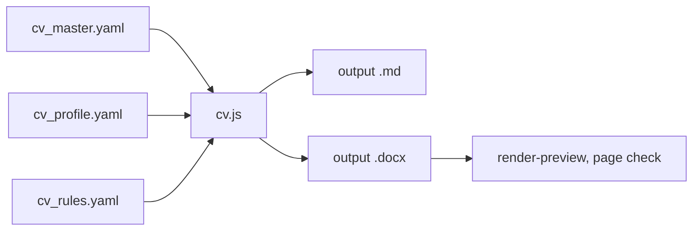

# Adapt the CV to a vacancy

Before the first step, read `${CLAUDE_SKILL_DIR}/../../reference/workspace.md` (workspace layout, settings and
precedence) and `${CLAUDE_SKILL_DIR}/../../reference/rules.md` (core rules, documents, style). Then read the
workspace `CLAUDE.md`: it overrides the plugin defaults. Run every command from the workspace root.

Use the conversation language and the documents language (for the CV) from the workspace settings. Never invent
experience: the only sources are `MyProfile/candidate_facts.md` and `MyProfile/cv/cv_master.yaml`.

Every CV is built from the master and a profile:

Summary: the master holds all CV text; the profile selects and orders it for one vacancy; the build checks the wording
rules and writes the `.md` (for `git diff`) and the `.docx`; the preview shows the pages.

If `jobsearch-kit:analyze-vacancy` invokes this skill, the application folder already has `vacancy.md` and `fit-analysis.md`, and
the user has answered the gap questions. In that case:

1. In step 1, read `vacancy.md` and `fit-analysis.md` instead of the vacancy page.
2. Skip the table and the questions of step 2. Show only the CV proposals (what to emphasise, rename, cut or
   reorder, ATS keywords).
3. Wait for the user to confirm the proposals. Then do step 3.
4. In step 5, ask the user to check the CV and make the PDF as usual, but do not offer a cover letter and do not
   write the log. `jobsearch-kit:analyze-vacancy` does these.

## 1. Gather inputs

1. Read the vacancy with the built-in browser (`navigate`, then `get_page_text`). If the user gives the vacancy as
   text, use the text and record "text from the user, <date>" as the source. Record the company, legal entity,
   title, location, work model, requirements, "nice to have" items, tech stack and eligibility rules (citizenship,
   work permit, language) in `<folder>/vacancy.md` in the notes language.
2. Read `MyProfile/candidate_facts.md` and `MyProfile/cv/cv_master.yaml`.
3. Find the newest `cv_profile.yaml` in another application folder (by the folder date). It is the starting point of
   the new profile. If no application folder has one yet, start from `MyProfile/cv/profile_full.yaml`.
4. Check that the master is current. If it misses confirmed facts from `candidate_facts.md`, tell the user and run
   `jobsearch-kit:update-cv-facts` first.

## 2. Gap analysis (show it to the user before building anything)

1. Present a table: requirement, evidence in the CV, status (✅ confirmed / 🟡 partial / ❌ missing /
   ❓ not in the facts, question to the user).
2. List concrete proposals: what to emphasise, rename, cut or reorder, and which keywords to add for ATS. Check
   every version that the vacancy names (".NET 8", "Java 17"): if the facts cover it by a confirmed range, name it in
   the CV next to the newer version; if the facts name only a newer version, ask (`rules.md`, "Versions of one
   product").
3. Ask targeted questions **only** about requirements that `candidate_facts.md` does not cover. Never fill gaps by
   guessing.
4. Wait for the answers. If the user confirms a new fact, run `jobsearch-kit:update-cv-facts`.

## 3. Write the profile

1. If the application folder does not exist, create `YYYY_MM_DD_<Company>/` (today's date).
2. Copy the newest profile to `<folder>/cv_profile.yaml`. Set
   `output: <date>_CV_<Name>_<Company>`, where `<date>` is the folder date and `<Name>` is `header.name` from the
   master with underscores for spaces.
3. Change the profile for the vacancy. The full format is at the top of `scripts/cv.js`. The main parts:
   - `title`: an id from `titles` in the master, or literal text close to the vacancy title.
   - `sections`: the order of sections; for each section, the selection:
     - `text`: a summary variant (`variant`) or a summary written for this vacancy (`text`); lead with what the role
       asks for;
     - `items` and `groups`: `all` or a list of ids; order the skill groups by the vacancy's priorities;
     - `jobs`: for each job, `bullets` as `all`, a list of ids, or `{ tags: [...] }`; put the strongest matching
       achievements first; `extra` adds vacancy-specific bullets.
   - Merging jobs: a bullet list may hold `<job id>:<bullet id>` to take bullets from another master job into one
     entry, and `{ subhead: "..." }` to start a subhead. Use this to show parallel or consecutive roles at one
     employer as one entry. `groups: false` hides the group subheads of a job.
   - `replace`: `[ { from, to } ]` for vacancy-specific wording; every `from` must be found, or the build fails.
   - `contacts`: `{ <contact id>: "new text" }` to change a contact line, or `null` to drop it.
4. Put vacancy-specific wording into the profile (`text`, `extra`, `replace`). If the wording is true in general, put
   it into the master instead (run `jobsearch-kit:update-cv-facts` if it is a new fact), so that the next CV gets it too.
5. Keep the CV to 2–3 pages.

## 4. Build and check

1. Build: `node "${CLAUDE_SKILL_DIR}/../../scripts/cv.js" <folder>/cv_profile.yaml`. It writes `<output>.md` and `<output>.docx` next to the
   profile. `**bold**` works inside text.
2. If a wording rule fails, fix the text. Change `cv_rules.yaml` only when `candidate_facts.md` changed; never weaken
   a rule to pass the build.
3. Review the text: compare `<output>.md` with the `.md` of the profile you started from (`git diff --no-index`), so
   that you see every selection change.
4. Render in pwsh: `pwsh -File "${CLAUDE_SKILL_DIR}/../../scripts/render-preview.ps1" -Docx <folder>/<output>.docx`, then read
   `%TEMP%\jobsearch\preview\page*.png`.
5. Check the page count, headings left alone at the bottom of a page, header lines that wrap, and empty pages. Fix
   the profile, rebuild and render again until the pages are clean.
6. If Word locks the `.docx`, ask the user to close it. Do not close a Word window that the user opened.

## 5. Report and hand over

1. If `applications.md` has no row for this vacancy, add one with the status "not submitted" (in the notes language)
   and a short comment. `jobsearch-kit:submit-application` reads this row later.
2. Tell the user what changed, which claims they should double-check, and any eligibility risks.
3. Ask the user to check the CV. Send the `.docx` with `SendUserFile` (`display: attach`); if that tool is not
   available, give its path. Ask whether the CV is correct and whether to make the PDF. Wait for the answer.
   - If the user asks for changes, change the profile (or the master through `jobsearch-kit:update-cv-facts`), build
     and check again (step 4), and ask again.
   - If the user confirms the CV, export the PDF in pwsh:
     `pwsh -File "${CLAUDE_SKILL_DIR}/../../scripts/export-pdf.ps1" -Docx <folder>/<output>.docx`. Check that the
     page count is the same as in step 4 and that every contact link of the header is in the printed link list. Send
     the PDF with `SendUserFile` (`display: render`), or give its path.
   - If the CV changes after the PDF was made, rebuild the PDF too: a PDF must never be older than its `.docx`.
4. Offer a cover letter. If the user accepts, invoke the `jobsearch-kit:cover-letter` skill with the Skill tool and give it the
   application folder.
5. When the user is ready to submit, invoke the `jobsearch-kit:submit-application` skill. It checks the PDFs and
   drafts the form answers.
6. Add a work log entry to `README.md` in the notes language: the vacancy link, the status ("CV prepared" until the
   user says it was submitted), the changes and open follow-ups.
7. Do not commit. Offer the commit to the user and commit only if they say so. Never push.

## Older formats

- Older application folders may have `cv_content.json` instead of a profile. Rebuild them only if needed:
  `node "${CLAUDE_SKILL_DIR}/../../scripts/build-cv.js" <folder>/cv_content.json <out.docx>`.
- The workspace may keep archived Word CVs in their original layout (the workspace `CLAUDE.md` names them). Do not
  change them and do not create new versions. If the user ever asks for an XML edit of such a file:
  - Unzip it with `Expand-Archive` in pwsh (Windows PowerShell 5.1 refuses the `.docx` extension).
  - Edit `word/document.xml` with a Node script. Match paragraphs by their text, clone the neighbouring paragraph's
    `pPr`/`rPr`, and strip `w14:paraId`/`w14:textId` from clones. A hyperlink needs a new relationship in
    `word/_rels/document.xml.rels`.
  - Check the script's exit code before zipping: a failed script can leave a copy of the unmodified original.
  - Zip with `[IO.Compression.ZipFile]::CreateFromDirectory`.
  - Check the page layout afterwards: a moved table or column can leave an almost empty page.
