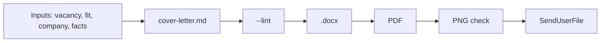

# Write and build a cover letter

Before the first step, read `${CLAUDE_SKILL_DIR}/../../reference/workspace.md` (workspace layout, settings and
precedence) and `${CLAUDE_SKILL_DIR}/../../reference/rules.md` (core rules, documents, style). Then read the
workspace `CLAUDE.md`: it overrides the plugin defaults. Run every command from the workspace root.

Use the conversation language and the documents language (for the letter) from the workspace settings. Before you
write, read the "Cover letters" section of `rules.md` and the cover letter preferences of the workspace (what a
letter must not contain).



Summary of the flow: write `cover-letter.md` from the inputs, lint it, build the `.docx` and the PDF, look at the
rendered pages, then show the PDF to the user.

## 1. Read the inputs

1. Get the application folder `YYYY_MM_DD_<Company>/`. If the user did not name it, take the newest folder for the
   company from `applications.md`. If no folder exists, run `jobsearch-kit:analyze-vacancy` first or ask the user.
2. Read `vacancy.md` and `fit-analysis.md` in the application folder. If they do not exist, read the vacancy page
   with the built-in browser (`navigate`, then `get_page_text`).
3. Read `_Companies/<Company>/` (README and people notes): mission, products, team, what matters to them.
4. Read `MyProfile/candidate_facts.md` and `MyProfile/cv/cv_master.yaml`. Take the name and the contacts from
   `header` in the master.
5. If the folder has a tailored CV (`cv_profile.yaml`, the built `.md`), read it. The letter must agree with it.
6. If an earlier `cover-letter.md` exists in another application folder, read the newest one as an example of the
   structure and tone. Do not copy its company-specific sentences.

## 2. Write `cover-letter.md`

1. Put front matter at the top:

   ```
   ---
   output: <date>_Cover_Letter_<Name>_<Company>
   date: <D Month YYYY>
   ---
   ```

   `<date>` is the application folder date (`YYYY_MM_DD`). `<Name>` is `header.name` with underscores for spaces.
   `<Company>` is the part of the folder name after the date. The format is documented at the top of
   `scripts/build-letter.js`.
2. Write one line per paragraph, with a blank line between paragraphs. Do not hard-wrap: the user pastes the text
   into web forms.
3. Use this structure:
   - a greeting (a named person only if the vacancy names the hiring manager; else "Dear Hiring Team,");
   - one sentence: the exact vacancy title, the team and the city;
   - the strongest matches to the vacancy's main requirements, with facts and numbers from `candidate_facts.md`;
   - the gaps from `fit-analysis.md`, said honestly ("I have not worked with X yet"), with the nearest real
     experience and the readiness to learn;
   - why this company and team: one or two points from the company research that connect to the user's experience;
   - a short closing and thanks;
   - a sign-off block: "Kind regards," and the name and the contacts (phone · e-mail) on separate lines of one block.
4. Keep the body to 250–350 words. Count the words without the front matter and the sign-off block.
5. Use the style for CVs and cover letters (`rules.md`, "Writing style", unless the workspace sets another): active
   voice, no noun clusters, rich vocabulary. Use the vacancy's keywords and
   technology names.
6. Use only confirmed facts. If the letter needs a fact that is not in `candidate_facts.md`, ask the user. Then run
   `jobsearch-kit:update-cv-facts` with the answer.
7. Check the text against the "Cover letters" section of `rules.md` and the cover letter preferences of the
   workspace.

## 3. Lint

1. Run `node "${CLAUDE_SKILL_DIR}/../../scripts/cv.js" --lint <folder>/cover-letter.md`.
2. If a rule fails, change the text. Do not change `cv_rules.yaml` to pass the lint. If a fact really changed, run
   `jobsearch-kit:update-cv-facts`.
3. If an honest negation fails, check that it starts with a form that the `negation` pattern in `cv_rules.yaml`
   accepts ("I have not ...").

## 4. Build and check

1. Build the `.docx`: `node "${CLAUDE_SKILL_DIR}/../../scripts/build-letter.js" <folder>/cover-letter.md`.
2. Build the PDF in pwsh: `pwsh -File "${CLAUDE_SKILL_DIR}/../../scripts/export-pdf.ps1" -Docx <folder>\<output>.docx`. If Word locks the file,
   ask the user to close it. Do not close Word yourself.
3. Render the PDF to PNG in Windows PowerShell 5.1:
   `powershell.exe -NoProfile -ExecutionPolicy Bypass -File "${CLAUDE_SKILL_DIR}/../../scripts/pdf-to-png.ps1" -Pdf <pdf> -OutDir %TEMP%\jobsearch\letter`.
4. Read the PNG files. The letter must fit on one page. Check the date, the greeting, the sign-off and the contacts.
5. If the page check fails, shorten the text and repeat steps 3–4 of this section and section 3.
6. After every text change, rebuild both the `.docx` and the PDF. Never edit the `.docx` or the PDF by hand.

## 5. Show it

1. Send the PDF with `SendUserFile` (`display: render`).
2. Tell the user the word count, which gaps the letter names and any sentence they should check.
3. If the form has a cover letter text field, tell the user that `cover-letter.md` can be pasted as it is (without
   the front matter).
4. If the calling skill (`jobsearch-kit:analyze-vacancy`, `jobsearch-kit:adapt-cv`) writes the log, stop here. Otherwise add a work log entry to
   `README.md` and offer a commit. Commit only when the user says so.
