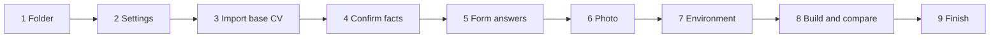

# Set up a job search workspace

Before the first step, read `${CLAUDE_SKILL_DIR}/../../reference/workspace.md` (workspace layout, settings and
precedence) and `${CLAUDE_SKILL_DIR}/../../reference/rules.md` (core rules, documents, style).

The skeleton of a workspace is `${CLAUDE_SKILL_DIR}/../../templates/workspace/`: the files and formats with header
comments and placeholders (`<...>`), without any person's data.

**Never invent a fact. Never mark a fact as confirmed that the user did not confirm.** A statement taken from the
base CV is marked "from the CV, <date>" until the user confirms it; then it becomes "confirmed <date>".

Summary: create the folder from the skeleton, record the settings, draft the facts and the master CV from the base
CV, let the user confirm every fact, fill the form answers, check the tools, build the full CV, compare it with the
base CV, and end with a message that says whether the workspace is ready and points to `analyze-vacancy`.

Ask the questions of one step together in one message. Wait for the answers before you write the files of that step.
If the user gives all answers up front, do not ask again.

## 1. Folder

1. Ask where the workspace goes. If the user already works in an empty folder, offer that folder.
2. If the folder exists and is not empty, list what is in it and ask whether to continue. Never overwrite a file
   without a yes.
   - If the folder holds a workspace that an earlier run did not finish (for example `MyProfile/` exists, but the
     full CV `.docx` or the git repository is missing, or a placeholder is left), tell the user which steps are done
     and offer to continue from the first step that is not done.
3. If the folder holds `tools/` or `.claude/skills/` with older copies of the job search skills, tell the user that
   the plugin replaces them, and offer to delete them. Delete only after a yes.
4. Copy the skeleton into the folder: every file and folder of `templates/workspace/`, including `.gitignore`. Keep
   files that exist (for example a `MyProfile/candidate_facts.md` of an older workspace) and tell the user which.
5. Run every later command from the workspace root.

## 2. Settings

1. Ask for the workspace settings of `workspace.md` ("Workspace settings"): conversation language, notes language,
   documents language, recruiter messages, cover letter preferences (for example: no start date, no referrer, no
   recruiter name), writing style, archived files. Offer the defaults.
2. Write the answers into the "Workspace settings" section of `CLAUDE.md`. Replace every placeholder.

## 3. Import the base CV

1. Ask for the base CV: a `.docx`, a `.pdf`, plain text, or a LinkedIn profile export (PDF or the `Profile.csv` and
   `Positions.csv` files of the data export).
2. Extract the text:
   - `.docx`: read `word/document.xml` from the zip and strip the tags (`Expand-Archive` in pwsh; Windows PowerShell
     5.1 refuses the `.docx` extension, so copy the file to `.zip` first).
   - `.pdf`: read the file with the Read tool. If that fails, extract the text with a PDF text tool.
   - Text or CSV: read it as it is.
   Save the extracted text as `MyProfile/cv/archive/base-cv.txt`, one paragraph per line. If the base CV is a file,
   copy it to `MyProfile/cv/archive/` too. Add both to "Archived files" in `CLAUDE.md`. Step 8 compares the built CV
   with this text.
3. Draft `MyProfile/candidate_facts.md` from the text, in the language the user chooses for it:
   - contacts and status (name, e-mail, phone, location, links);
   - experience (per job: period, title, company, city, stack, responsibilities and results);
   - key metrics (only numbers that the CV states);
   - skills by level (the level stays "not confirmed" until step 4).
   Mark every statement "from the CV, <today>". If the CV has nothing for a section, delete the placeholder line of
   that section; do not write a bullet such as "No projects".
4. Draft `MyProfile/cv/cv_master.yaml` in the documents language (format at the top of
   `${CLAUDE_SKILL_DIR}/../../scripts/cv.js`): `header` (name, contacts with `url` for links), `titles`, a summary
   with variants, a skills `list`, skill `groups`, `jobs` with tagged bullets (`tags` by topic, for example `api`,
   `data`, `lead`), `projects`, education. Keep the verbs and numbers of the base CV. Do not add skills or results
   that the base CV does not state.
5. In `MyProfile/cv/profile_full.yaml`, set `output: CV_<Name>_full` (`<Name>` is `header.name` with underscores for
   spaces) and a `title` id that exists in `titles`.

## 4. Confirm, do not invent

1. Show the drafted facts grouped by section. Ask the user to confirm or correct them.
2. Ask explicitly for what a CV does not say:
   - the level of each skill: production, working knowledge, or none;
   - for the main platforms and languages of the CV (for example .NET, Java, Python, Angular): the range of versions
     the user worked with, so that a vacancy that names an older version is covered (`rules.md`, "Versions of one
     product"). Ask it only if the CV names versions. If the user does not answer it, keep the versions of the CV
     and continue;
   - the salary expectation (amount, currency, gross or net, per month or year, contract type);
   - the earliest start date or notice period;
   - the right to work (citizenship, work permit, sponsorship);
   - languages and their levels;
   - "do not claim" limits: technologies, domains or roles the user must never claim.
3. Write the answers into `candidate_facts.md`. Change the mark of each confirmed statement to "confirmed <today>".
   A statement drafted from the base CV is confirmed only by the user's answer to the draft that you showed. Answers
   given before you showed the draft (skill levels, salary, limits) confirm those answers only, not the CV
   statements around them: a job, a result or a number from the CV stays "from the CV" until the user confirms the
   draft. Write a user's answer about a CV statement as its own line, so that the CV statement keeps its own mark.
   Keep "from the CV, <date>" on statements that the user did not confirm, and tell the user which ones.
4. Mark salary, start date and similar statements "Not for CVs".
5. Turn each limit into a rule in `MyProfile/cv/cv_rules.yaml` (field description at the top of the file). Keep the
   `negation` anchor. Use `allow: *negation` for "no experience with X" limits, `unless: working knowledge` for
   "working knowledge only" limits. Put the date of the fact into each `message`.
6. If a correction changes CV text, change the master too.

## 5. Form answers

1. Fill `MyProfile/application_defaults.yaml` from the confirmed facts: right to work, salary, start date, languages.
   Give each answer its `source` (the section of `candidate_facts.md` and the date).
2. Set `status: confirmed` only for answers that come from confirmed facts. Set `status: ask` for every other answer
   (for example "How did you hear about this job?").

## 6. Optional photo

1. Ask whether the CV has a photo. If yes, ask for the file and copy it to `MyProfile/photo.jpg` (or `.png`).
2. Set `header.photo` in the master. If no, leave `header.photo` out.

## 7. Environment

1. Check the tools: `node --version`, `pwsh --version`, `git --version`, and Word (the registry key
   `HKEY_CLASSES_ROOT\Word.Application`).
2. If a tool is missing, tell the user what it is needed for (`${CLAUDE_SKILL_DIR}/../../reference/scripts.md`,
   "Environment") and how to install it. Do not install system programs yourself.
3. If the npm packages are missing (`cv.js` reports it), run
   `pwsh -File "${CLAUDE_SKILL_DIR}/../../scripts/install-deps.ps1"`.
4. Offer the whisper environment for call transcripts (`install-whisper.ps1`). Say that it is optional and a large
   download (about 3 GB with the model). Run it only after a yes.

## 8. First build and comparison

1. Build the full CV: `node "${CLAUDE_SKILL_DIR}/../../scripts/cv.js" MyProfile/cv/profile_full.yaml`. If a wording
   rule fails, fix the master text, not the rule.
2. Render the preview in pwsh: `pwsh -File "${CLAUDE_SKILL_DIR}/../../scripts/render-preview.ps1" -Docx
   MyProfile/cv/<output>.docx`, then read `%TEMP%\jobsearch\preview\page*.png`. Check the page count, the header and
   empty pages. Show the user the result.
3. Compare the built CV with the base CV, so that nothing of the base CV is lost or changed without the user knowing
   it:
   - Run `node "${CLAUDE_SKILL_DIR}/../../scripts/compare-cv.js" <base> MyProfile/cv/<output>.md`. `<base>` is the
     copy of a `.docx` base CV in `MyProfile/cv/archive/`, or else `MyProfile/cv/archive/base-cv.txt`. If neither
     exists (an earlier run did not save them), use the base CV that the user gives, and save them now.
   - Explain every line of the report "Lost", "Changed", "Added" and "Numbers" with one of these kinds:
     - **your correction:** the user changed it in step 4; name the fact and its date;
     - **regrouped:** the same text in another place or under a label;
     - **lost:** the base CV says it, and the facts or the CV do not;
     - **no source:** the CV says it, and neither the base CV nor a confirmed fact does.
     Do not leave a line without a kind. If no fact explains a line, it is lost or has no source.
   - Show the user a table: base CV, new CV, kind, proposal. For each lost line, propose to add it back; for each line
     without a source, propose to remove it. Wait for the answers.
   - Make each change in `candidate_facts.md` and the master, as in step 4. Mark a line that the user confirms
     "confirmed <today>". Rebuild the CV and run the comparison again, until only "your correction" and
     "regrouped" lines are left, or the user decides to keep a difference.
   - Remember the result for the final message: lines lost, changed by the user, regrouped.
4. Check that no placeholder (`<...>`) is left in `CLAUDE.md`, `MyProfile/` and `README.md`.
5. Add a work log entry to `README.md` in the notes language: the workspace was set up, the source of the facts, the
   statements that are still "from the CV", the open questions.
6. If the folder is not a git repository, run `git init`.
7. Offer the first commit. Commit only after a yes.

## 9. Finish and next step

End the setup with one final message in the conversation language. The user must see clearly whether the setup is
finished.

1. If the full CV is built and the first commit is made, start the message with "The workspace is ready" (in the
   conversation language). Then list:
   - what was created: the facts, the master CV, the wording rules, the form answers, the full CV (`.md` and
     `.docx`);
   - the comparison with the base CV: lines lost and added back, lines changed by the user, lines regrouped;
   - the statements that are still "from the CV", and the open questions;
   - the next step: share a vacancy link (or its text) and ask to analyze it. The `analyze-vacancy` skill builds the
     fit table, researches the company and then makes the CV and the letter.
2. If a step is not done (for example the build failed, or the user did not agree to the commit), do not say that the
   workspace is ready. Start the message with "The workspace setup is not finished" (in the conversation language),
   name the steps that are left, and tell the user to say "continue the workspace setup" to finish them.
