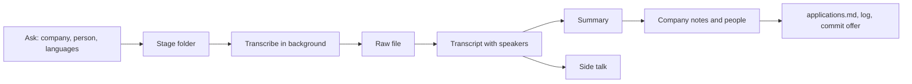

# Process a call recording

Before the first step, read `${CLAUDE_SKILL_DIR}/../../reference/workspace.md` (workspace layout, settings and
precedence) and `${CLAUDE_SKILL_DIR}/../../reference/rules.md` (core rules, documents, style). Then read the
workspace `CLAUDE.md`: it overrides the plugin defaults. Run every command from the workspace root.

Use the conversation language from the workspace settings. The transcript keeps the languages of the call; the
summary and the side notes are in the notes language.



Summary: create the stage folder, transcribe the recording, write four files from the transcript, then update the
company notes and the records.

## 1. Ask

Ask only what is not clear from the user's message or the file name:

1. The company and the application (`applications.md` row, application folder).
2. The other person or people on the call, and their roles.
3. The languages of the call, and the time when the language changed, if the user remembers it.
4. The date of the call. If not given, take it from the file name or the file time.

## 2. Create the stage folder

1. Create `YYYY_MM_DD_<Company>/` with the date of the call. If the folder of the same date is the application folder,
   use `YYYY_MM_DD_<Company>_<Stage>/` instead (for example `_Interview`). Stage files never go into the application
   folder.
2. Move the recording into the stage folder. Keep its original file name.

## 3. Transcribe

Run in the background (on a CUDA GPU, a few minutes per hour of audio for each language). `<whisper>` is the
`JOBSEARCH_WHISPER` folder, else `%LOCALAPPDATA%\ai-plugins\jobsearch-kit\whisper`:

```
<whisper>\.venv\Scripts\python.exe "${CLAUDE_SKILL_DIR}/../../scripts/transcribe.py" <audio> %TEMP%\jobsearch\<date>_call <options>
```

- One language: `--language en` (or `ru`, `uk`, ...).
- Several languages with a known switch time: `--languages en,ru --switch 00:12:30`.
- Several languages, switch time unknown: `--languages en,ru`. The script detects the language per 30-second window.
  Read `<prefix>.languages.txt` and check each span against the text. If a span is wrong, rerun with `--switch`.

If the venv does not exist, run `pwsh -File "${CLAUDE_SKILL_DIR}/../../scripts/install-whisper.ps1"` first.

While it runs, read `_Companies/<Company>/`, the application folder (`vacancy.md`, `fit-analysis.md`,
`interview-prep.md`) and `MyProfile/candidate_facts.md`. You need them to fix names and to check what the user said.

## 4. Write the files

Use the files of an earlier call as the reference format: the newest `*_call_*_summary.md`, `*_transcript.md` and
`*_side_talk.md` in another stage folder. `<Person>` is the first name of the main other person.

1. **`<date>_call_<Person>_raw_whisper.txt`**: the `.txt` output of the script. Add one first line:
   `# Raw faster-whisper output, <date> <Company> call. <which pass covers which time span>`.
2. **`<date>_call_<Person>_transcript.md`**, in the languages of the call:
   - a header: the recording link, its length, how it was transcribed (model, passes and switch time), a link to
     the raw file;
   - a speaker key (one letter per person); label the speakers by meaning;
   - fix the names of companies, products and people with `_Companies/<Company>/` and `candidate_facts.md`;
   - remove filler words and broken starts, but do not change the meaning; mark unclear places as "[unclear]" in
     the notes language;
   - a time stamp `[mm:ss]` at the start of each new topic; a section per language part.
3. **`<date>_call_<Person>_summary.md`**, in the notes language:
   - first paragraph: the result of the call and the main risk (the answer first);
   - links to the transcript, the side talk, the company notes and the application folder;
   - a "main points" section (name the sections as in the reference file): a numbered list of facts with time
     stamps; a Mermaid diagram if the call described the hiring stages, a team or a timeline;
   - a "nuances and risks" section: what the user said that conflicts with `candidate_facts.md`, the CV or an
     earlier answer; what may weaken the position; keep facts and conclusions (a sentence that starts with
     "Conclusion:" in the notes language) in separate sentences;
   - a "next steps" section: a checklist (`- [ ]`) of follow-ups with dates.
4. **`<date>_call_<Person>_side_talk.md`**, in the notes language: everything else that may matter later (team
   structure, office, equipment, benefits, what the user told about themselves), with time stamps.

Write the notes by the style rules for notes (`rules.md`, "Writing style", unless the workspace sets another).

## 5. Check facts and research people

1. If the user stated a new fact on the call (salary named, start date, a skill), ask the user to confirm it. Then
   run `jobsearch-kit:update-cv-facts`.
2. For each new person mentioned on the call, look them up on LinkedIn in the built-in browser. If LinkedIn needs a
   sign-in, ask the user to sign in and wait. Read only: never connect, message, like or follow.
3. Add what you found to `_Companies/<Company>/` (`people.md` or `README.md`), with the source and the date. Add the
   call's facts about the company (process, team, salary policy, benefits) to the company notes with the call date.

## 6. Records

1. Update the row in `applications.md`: the stage, the result, the next step (notes language).
2. If the call set a date or a promise (a letter, a next interview), add it to the next steps and tell the user. If
   memory holds a reminder for this company, update it.
3. Add a work log entry to `README.md` in the notes language: the call, the stage folder, the main results, open follow-ups.
4. Offer a commit. Commit only when the user says so. Recordings stay local: never add them to a commit. If
   `.gitignore` does not exclude the recording's extension (`*.mp3`, `*.m4a`, `*.wav`), suggest adding it.
