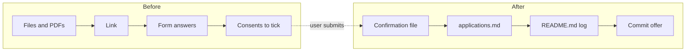

# Submit an application

Before the first step, read `${CLAUDE_SKILL_DIR}/../../reference/workspace.md` (workspace layout, settings and
precedence) and `${CLAUDE_SKILL_DIR}/../../reference/rules.md` (core rules, documents, style). Then read the
workspace `CLAUDE.md`: it overrides the plugin defaults. Run every command from the workspace root.

Use the conversation language, the notes language and the documents language (for form answers) from the workspace
settings.

**Never click, tick, submit or send anything for the user.** The user fills in and submits the form. This skill only
checks the files and drafts the answers.

The skill has two parts. Run the part that fits the user's message:

Summary: before submission, check the files, the link and the answers, and list the boxes that the user must tick.
After the user submits, record the confirmation, the status and the log.

## Part 1. Before submission

### 1.1 Find the application

1. Get the application folder `YYYY_MM_DD_<Company>/`. If the user did not name it, take the newest folder for the
   company in `applications.md`.
2. Read the row of the vacancy in `applications.md` and `vacancy.md` in the folder.

### 1.2 Check the files

1. Find the tailored CV (`cv_profile.yaml`, `<output>.md`, `<output>.docx`) and, if it exists, the cover letter
   (`cover-letter.md` and its `.docx`).
2. Check the CV by its text, not by file times (a change in the master or the rules may not touch this CV):
   run `node "${CLAUDE_SKILL_DIR}/../../scripts/cv.js" <folder>/cv_profile.yaml --no-docx`, then `git diff --exit-code -- <folder>/<output>.md`.
   - If the diff is empty, the CV text is current.
   - If the diff is not empty, show it to the user. If the user accepts it, rebuild the `.docx`:
     `node "${CLAUDE_SKILL_DIR}/../../scripts/cv.js" <folder>/cv_profile.yaml`. If not, restore the `.md` with `git checkout -- <file>`.
   - If the `.md` is not in git yet (`git ls-files --error-unmatch <file>` fails), `git diff` says nothing: rebuild
     the `.docx` without the diff.
3. Check the cover letter by time: if `cover-letter.md` is newer than its `.docx`, rebuild it with the build part of
   the `jobsearch-kit:cover-letter` skill.
4. If a PDF is missing or older than its `.docx`, export it in pwsh: `pwsh -File "${CLAUDE_SKILL_DIR}/../../scripts/export-pdf.ps1" -Docx <docx>`.
   It writes the PDF next to the `.docx` and prints the page count and the links. Never use "Microsoft Print to
   PDF": it drops every hyperlink.
5. Check the export output of the CV: it must list every link (`url`) of `header.contacts` in the master that the
   profile keeps. If a link is missing, find the cause before the user submits.
6. If the layout is not checked yet, run `pwsh -File "${CLAUDE_SKILL_DIR}/../../scripts/render-preview.ps1" -Docx <docx>` in pwsh and read
   `%TEMP%\jobsearch\preview\page*.png`. Check the page count, headings left alone at the bottom of a page, wrapped
   header lines and empty pages.
7. If Word locks a file, ask the user to close it. Do not close a Word window that the user opened.
8. Run `node "${CLAUDE_SKILL_DIR}/../../scripts/cv.js" --lint` on the cover letter and on `form-answers.md` if it exists. That file holds only
   free-text answers (motivation, "why us"); the same rules apply as to a letter (for example, the workspace may
   forbid the start date and referral details there). Factual answers (salary, start date, referrer name) go into
   the table of step 1.4, not into a file.

### 1.3 Check the link

1. If `applications.md` or `vacancy.md` records a referral link for the vacancy, tell the user to submit through that
   link only. Show the link. If no referral link is recorded, show the vacancy link and skip step 2.
2. If the user sends a screenshot of the form, check that its address carries the referral parameters (for
   SmartRecruiters, the `rsid` of the referral link). If it does not, tell the user before they continue.

### 1.4 Draft the form answers

1. Read `MyProfile/application_defaults.yaml`.
2. Read the questions from the user's screenshots or text. For each question, find the matching answer by meaning,
   not by exact wording.
3. If an answer has `status: confirmed`, give it. Respect its `note` (cases where the answer is different).
4. If an answer has `status: ask`, or no answer matches, ask the user. Never guess. If the user confirms a new fact,
   run `jobsearch-kit:update-cv-facts` and add the answer to `application_defaults.yaml` with the source and the date.
5. For a free-text question (motivation, "why us"), draft an answer from `candidate_facts.md`, `fit-analysis.md` and
   `_Companies/<Company>/`. Apply the "Cover letters" section of `rules.md` and the cover letter
   preferences of the workspace. If the user wants to keep it, save it as
   `<folder>/form-answers.md` and lint it.
6. Show all answers as a table: question, answer to type or option to choose, source.
7. Tell the user which file goes into which upload field (Resume, Cover letter, Additional attachments). Use the PDF
   files.

### 1.5 Consents

1. List every consent box on the form (data processing, talent pool, terms, newsletters).
2. Say which boxes the form requires and which are optional. The user decides and ticks them.

Then stop. Tell the user to submit the form and to send the confirmation (screenshot or e-mail) afterwards.

## Part 2. After submission

1. If the user gives a confirmation screenshot, save it in the application folder as `Confirmation_<YYYY_MM_DD>.png`
   (the date of submission). Save employer replies in the same folder with a name that says what they are and the
   date (for example `Invitation_2026_10_19.png`).
2. Make sure that all files of the application are in the folder: `cv_profile.yaml`, the built CV `.md`, `.docx` and
   PDF, the cover letter files, `vacancy.md`, `fit-analysis.md`, `form-answers.md` if any. Do not put files of later
   stages (calls, interviews) here: they go into a stage folder.
3. Update the row of the vacancy in `applications.md`, in the notes language: the date sent, and a short comment (the link used,
   whether it is a referral and who shared it, the attached files, the salary named in the form, the confirmation
   file). If the row does not exist, add it. If something is unknown (who shared the link), ask the user.
4. Add a work log entry to `README.md` in the notes language: the vacancy link, the status "sent <date>" (in the notes language), the attached
   files, the form answers, the confirmation file and open follow-ups.
5. If an answer in the form differed from `application_defaults.yaml`, ask the user whether to update the defaults.
6. Offer a commit. Commit only when the user says so. Never push.
