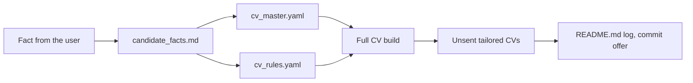

# Update the candidate facts and the master CV

Before the first step, read `${CLAUDE_SKILL_DIR}/../../reference/workspace.md` (workspace layout, settings and
precedence) and `${CLAUDE_SKILL_DIR}/../../reference/rules.md` (core rules, documents, style). Then read the
workspace `CLAUDE.md`: it overrides the plugin defaults. Run every command from the workspace root.

Use the conversation language from the workspace settings. Write each file in the language that the workspace
settings give for it; keep `candidate_facts.md` in the language it already uses.

The files of this skill:

| File | Role |
|---|---|
| `MyProfile/candidate_facts.md` | Source of truth for facts |
| `MyProfile/cv/cv_master.yaml` | Single source of CV text |
| `MyProfile/cv/cv_rules.yaml` | Wording rules; the CV build and `--lint` fail on a violation |
| `MyProfile/cv/profile_full.yaml` | Profile of the full CV |
| `applications.md` | Applications; shows which tailored CVs are not submitted yet |
| `MyProfile/application_defaults.yaml` | Standard answers for web forms, each with its source fact |

Summary of the flow: the fact goes to `candidate_facts.md` first. If it changes CV text, it goes to the master. If it
limits the wording, it becomes a rule. Then the full CV is rebuilt, and unsent tailored CVs are checked.

## 1. Get the fact

1. Take the fact from the user's message.
2. If something is missing, ask only for that: the date or period, the user's own role ("took part in" or "led"),
   numbers, and whether the fact may go into a CV.
3. Never add details that the user did not give. If a detail is unknown, write "not stated" or leave it out.

## 2. Add it to `candidate_facts.md`

1. Read the file. Find the section that fits (contacts and status, experience, key metrics, skills by level).
2. If an older statement about the same thing exists, change it and write what it replaces, for example
   "(confirmed <date>; replaces the earlier ...)". Do not keep two conflicting statements.
3. Write the date in every new or changed statement. If the source is the user, "confirmed <date>" or
   "from the user, <date>" (in the language of the file) is enough. Do not ask the user for another source.
4. If the fact must not appear in CVs (salary, residence plans), say "Not for CVs".

## 3. Change the master CV

Do this step only if the fact changes CV text.

1. Read `MyProfile/cv/cv_master.yaml`. Find the section, the job and the bullets on the same topic.
2. If a bullet already covers the topic, change its text. Keep its `id`, so that the profiles that select it get the
   new text.
3. If the fact is new, add a bullet with a new unique `id` and `tags` that match the existing tags of the job. Put it
   next to the bullets on the same topic.
4. If the fact changes a skill level, change the skill group text in `tech-skills`.
5. Use the style for CVs (`rules.md`, "Writing style", unless the workspace sets another): active voice, rich
   vocabulary, the wording limits of `candidate_facts.md`.

## 4. Add or change a wording rule

Do this step only if the fact limits the wording (for example "no experience with X", "say took part in, not led",
"working knowledge only").

1. Read the field description at the top of `cv_rules.yaml`.
2. Add a rule with `pattern`, `message` (with the date of the fact) and, if needed, `flags` and `unless`.
3. If honest negations such as "I have not worked with X" must pass, add `allow: *negation`.
4. If an existing rule already covers the topic, change that rule. Do not add a second one.
5. If a fact removes a limit (the user now has the experience), remove or relax the rule.

## 5. Rebuild the full CV

1. Run `node "${CLAUDE_SKILL_DIR}/../../scripts/cv.js" MyProfile/cv/profile_full.yaml`.
2. If a wording rule fails, fix the text in the master. Change `cv_rules.yaml` only if step 4 changed the facts.
3. Show the user `git diff` of `MyProfile/cv/<output>.md`, where `<output>` comes from `profile_full.yaml`. Check that
   the diff holds only the intended change.
4. If the layout can change (a new bullet, a longer text), check the pages: run
   `pwsh -File "${CLAUDE_SKILL_DIR}/../../scripts/render-preview.ps1" -Docx <full CV .docx>` in pwsh, then read `%TEMP%\jobsearch\preview\page*.png`.

## 6. Check the unsent tailored CVs

1. Read `applications.md`. Find the rows with the status "not submitted" (in the notes language) or an empty date
   that have a tailored CV
   (`<application folder>/cv_profile.yaml`).
2. Rebuild each one with `--no-docx` into the same folder and look at `git diff` of its `.md`. If the diff is empty, the
   fact does not touch it.
3. If the diff is not empty, show it and offer a full rebuild (`node "${CLAUDE_SKILL_DIR}/../../scripts/cv.js" <folder>/cv_profile.yaml`). If the
   user does not want it, restore the `.md` with `git checkout -- <file>`.
4. Never rebuild the CV of a submitted application: it must stay as it was sent.
5. If a `cover-letter.md` exists in an unsent application folder, run `node "${CLAUDE_SKILL_DIR}/../../scripts/cv.js" --lint <cover-letter.md>`.
   If it fails, tell the user.

## 7. Update the form answers

1. Read `MyProfile/application_defaults.yaml`.
2. If an answer depends on the fact (salary, start date, right to work, languages, on-call), change its `answer`,
   `source` and `note`. If the user confirmed an answer with `status: ask`, set `status: confirmed`.

## 8. Log and commit

1. Add a work log entry to `README.md` in the notes language: the fact, the files that changed, the rebuilt CVs.
2. Offer a commit. Commit only when the user says so.
