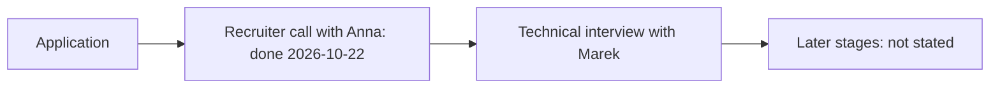

# Summary: recruiter call with Anna, Nordwind Pay, 2026-10-22

**Result:** the call passed. Anna invites the candidate to a technical interview with team lead Marek. The invitation is due by Friday, 2026-10-23. **Main risk:** on the call the candidate claimed Kubernetes cluster setup, which `candidate_facts.md` rules out. Marek will probably test this at the technical interview.

Links: [transcript](2026_10_22_call_Anna_transcript.md), [side talk](2026_10_22_call_Anna_side_talk.md), [company notes](../_Companies/Nordwind_Pay/README.md), [application folder](../2026_10_22_Nordwind_Pay/).

## Main points

1. **[00:00]** Anna, recruiter, called after the application for Senior Java Engineer.
2. **[00:13]** Anna asked about Kafka. The candidate named the settlement move (6 hours to 40 minutes) and Kafka in production since 2021. Both match the facts.
3. **[00:34]** Anna said the platform runs on Kubernetes. The candidate said: "I have a lot of experience with Kubernetes. I set up our clusters myself."
4. **[00:46]** The candidate named a salary expectation of about 5,500 EUR gross per month. Anna said it fits the range (the vacancy range is 4800–6200 EUR).
5. **[00:56]** Start date: the answer is partly lost. The recording has "[unclear] months after an offer".
6. **[00:58]** The candidate said they would relocate to Tallinn at own cost.
7. **[01:05]** Next step: technical interview with team lead Marek. Anna sends the invitation by Friday.
8. **[01:25]** The call switched to Russian. The team has six developers and one tester.
9. **[01:40]** Office days: 3 a week, usually Tuesday, Wednesday and Thursday. The office is in central Tallinn.
10. **[01:54]** On-call exists. Anna said "6 раз в 6 недель, неделя дежурства", paid separately. The exact rotation is unclear.

Summary of the diagram: the recruiter call is done. The technical interview with Marek is next. Later stages were not named on the call.

## Nuances and risks

- **Kubernetes.** `candidate_facts.md` says working knowledge only: the candidate deploys with existing Helm charts and never set up a cluster (2026-01-10). The CV and the cover letter say the same. On the call the candidate said the opposite. The candidate called the claim an exaggeration on 2026-10-22 and will correct it with Marek. Conclusion: the risk stays until the correction is made at the technical interview.
- **Salary.** The facts and `application_defaults.yaml` say 5000 EUR gross per month (2026-01-10). On the call the candidate said "around 5,500". The candidate confirmed 5000 EUR on 2026-10-22 (the 5,500 was a mistake).
- **Start date.** The facts say one month after an offer. The call has an unclear number of "months". The candidate confirmed one month after an offer on 2026-10-22.
- **On-call rotation.** "6 times in 6 weeks" reads as a slip. It may mean one week in every six. Conclusion: ask Anna or Marek.
- **Company.** Earlier web searches did not find Nordwind Pay. The call shows a real recruiter and a real process. Conclusion: the entity check in the register is still open.
- **Spelling.** The recording says "NordwayPay" and "Марик". The text uses Nordwind Pay (vacancy) and Marek (Anna's English). Conclusion: confirm the spelling in the interview invitation.

## Next steps

- [x] Candidate confirmed on 2026-10-22: the Kubernetes claim on the call was an exaggeration. The facts stay: working knowledge only. The candidate will correct this with Marek at the technical interview.
- [x] Candidate confirmed on 2026-10-22: salary is 5000 EUR gross per month; the 5,500 on the call was a mistake. The start term is one month after an offer, as in the facts. No fact changed, so `update-cv-facts` was not needed.
- [ ] 2026-10-23: expect the invitation from Anna. If it does not come, write to her.
- [ ] Prepare for the technical interview with Marek: Kafka settlement story, payment API, event-driven design, Kubernetes at the honest level.
- [ ] Ask about the on-call rotation.
- [ ] Check the entity in the Estonian business register.
